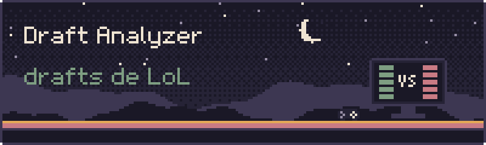
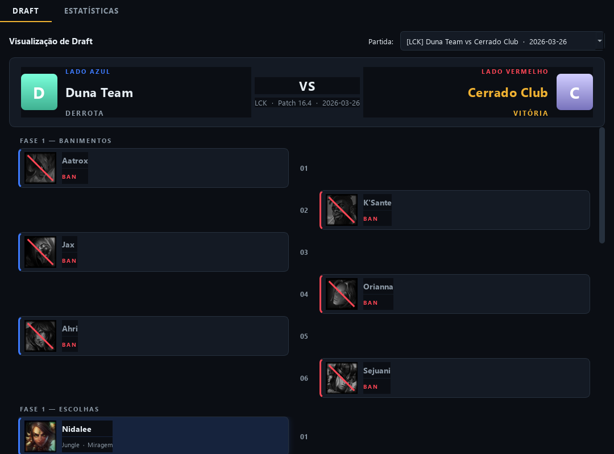
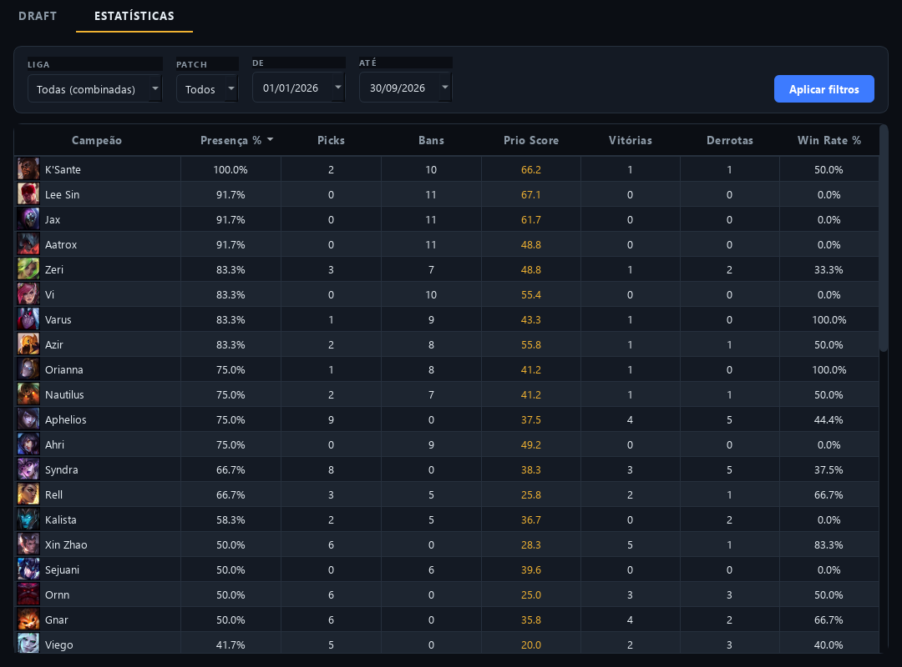

<p align="center">
  
</p>

<p align="center">
  <b>Análise de drafts e estatísticas de League of Legends competitivo.</b><br>
  Um app desktop em Python e Qt que lê os picks e bans de cada partida e mostra o que os times mais priorizam.
</p>

<p align="center">
  <a href="#como-rodar">Como rodar</a> ·
  <a href="docs/README.md">Documentação</a> ·
  <a href="docs/prio-score.md">Prio Score</a> ·
  <a href="https://eduardohenrique-nu.vercel.app">Portfólio</a>
</p>

<p align="center"></p>

<p align="center">
  
  
</p>

<p align="center"><sub>As capturas usam partidas fictícias, geradas pelo próprio projeto.</sub></p>

## O que é

Um app de estudo de draft, pensado para quem acompanha ou treina League of Legends. Ele guarda as partidas num banco local e oferece duas telas:

- **Draft**: escolhe uma partida e mostra o draft do jeito das transmissões, em leitura vertical. Cada ação (ban ou pick) ocupa uma linha, do lado do time que agiu, com o número da ordem no meio. O zigue-zague entre os lados revela quem escolheu o quê e quando. Bans aparecem dessaturados e riscados, e o vencedor ganha destaque dourado.
- **Estatísticas**: uma tabela de campeões com presença, picks, bans, **Prio Score**, vitórias, derrotas e win rate. Dá para ordenar por qualquer coluna e filtrar por liga, patch e intervalo de datas.

O recorte é de **2026 em diante**, para as ligas LEC, LCK, LPL, LTA North (ex-LCS) e LTA South (ex-CBLOL).

### Prio Score

Uma métrica de 0 a 100 que indica o quanto um campeão é priorizado no draft, juntando **frequência** e **precocidade**. Cada ação recebe um peso pela posição na ordem do draft (o first pick e os bans da fase 1 pesam muito, as escolhas finais pesam pouco), e o score é a soma dos pesos dividida pelo total de jogos do recorte:

```
PrioScore = 100 × (soma dos pesos de todas as aparições) / (total de jogos no recorte)
```

A explicação completa, com a escala e o porquê da normalização, está em [docs/prio-score.md](docs/prio-score.md).

## Como rodar

Precisa de Python 3.11 ou mais novo.

```bash
git clone https://github.com/eduardohenrique-dev/lol-draft-analyzer.git
cd lol-draft-analyzer

python -m venv .venv
.venv\Scripts\activate          # no Linux e no macOS: source .venv/bin/activate
pip install -r requirements.txt
```

Para ver o app funcionando na hora, grave as partidas fictícias e abra:

```bash
python tools/seed_demo.py
python main.py
```

Para trazer os ícones dos campeões (Riot Data Dragon):

```bash
python main.py --assets
```

Sem os ícones o app funciona igual: ele desenha um marcador com as iniciais do campeão. O passo a passo completo, com as opções de sincronização, está em [instalação e uso](docs/instalacao-e-uso.md).

### Sobre os dados reais

O projeto tem um cliente para a Leaguepedia (`python main.py --sync`), mas a API anônima dela limita as requisições de forma agressiva e o sync pode falhar ou demorar. A ideia é trocar essa fonte pela API da GRID, que entrega dados oficiais de partidas. Veja [fontes de dados](docs/fontes-de-dados.md) e o [roadmap](#roadmap).

## Testes

```bash
python -m unittest
```

Os testes cobrem a sequência do draft, a consistência dos dados de exemplo e o motor de estatísticas, incluindo uma conferência do Prio Score recalculado à mão.

## Como é por dentro

```
config.py        regras do domínio: sequência do draft, ligas, pesos, caminhos
main.py          ponto de entrada e flags (--sync, --assets, --online)
src/
  models/        dataclasses: GameDraft, DraftAction, TeamInfo
  backend/       banco SQLite, clientes da Leaguepedia e do Data Dragon,
                 gerenciador de ícones e o motor de estatísticas (pandas)
  ui/            janela, telas de draft e de estatísticas, tema e slot de campeão
  mock/          partidas fictícias
tools/           scripts de sincronização e de dados de exemplo
tests/           testes automatizados
```

O fluxo é **sincronizar (rede) → SQLite (cache) → interface (lê do cache)**: a interface nunca depende de rede para abrir. A visão completa está em [arquitetura](docs/arquitetura.md).

## Documentação

- [Instalação e uso](docs/instalacao-e-uso.md)
- [Arquitetura](docs/arquitetura.md)
- [Prio Score](docs/prio-score.md)
- [Banco de dados](docs/banco-de-dados.md)
- [Fontes de dados](docs/fontes-de-dados.md)
- [Desenvolvimento](docs/desenvolvimento.md)

## Roadmap

- Integração com a API da GRID para dados oficiais de partidas, no lugar da Leaguepedia.
- Exibir o nick dos jogadores em partidas reais (o cliente atual da Leaguepedia não traz esse dado).

---

<sub>LoL Draft Analyzer não é endossado pela Riot Games e não reflete as opiniões da Riot Games ou de quem trabalha com propriedades da Riot Games. Riot Games e todas as marcas associadas são marcas registradas da Riot Games, Inc.</sub><br>
<sub>Feito em Governador Valadares (MG). Código publicado para consulta; todos os direitos reservados.</sub>
